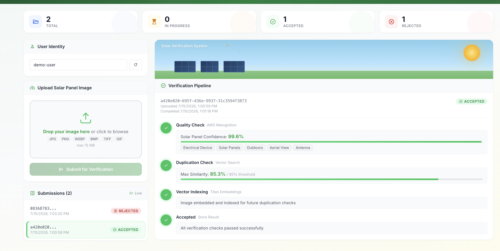

# Solar Panel Verification Portal // Image Verification and Analysis using Computer Vision & AWS Cloud

A serverless AWS application that verifies solar panel installation images submitted for government subsidy claims. The pipeline runs two checks: solar panel detection via Amazon Rekognition, and duplicate-image detection via Amazon Titan image embeddings stored in RDS PostgreSQL with pgvector.

---

## What It Does

1. User uploads a solar panel installation image through the web portal (hosted on AWS Amplify, ap-south-1) — or drops images directly into the batch intake S3 bucket for bulk processing.
2. Quality Check (Amazon Rekognition) confirms the image actually shows a solar panel and screens for inappropriate content.
3. Duplication Check generates a Titan image embedding and runs an indexed pgvector nearest-neighbor search against RDS PostgreSQL to detect resubmitted images.
4. Accepted images are indexed — the embedding is inserted into PostgreSQL so future submissions are checked against it.
5. Final ACCEPTED / REJECTED status is written to the `submissions` table with a full audit trail.

---

## Architecture


Editable source: [`solar-portal-architecture.drawio`](solar-portal-architecture.drawio)

All traffic between Lambdas and AWS services stays on the AWS backbone via VPC endpoints — no NAT gateway, no public egress. This mirrors a future hybrid topology where the data layer runs on Outposts/sovereign infrastructure with private connectivity back to the region for AI inferencing.

---

## Portal UI

Accepted submission — all checks passed, embedding indexed for future duplicate detection:



Rejected submission — pgvector found an exact duplicate (similarity 100% vs 95% threshold):


---

## Tech Stack

| Layer | Technology |
|-------|-----------|
| Frontend hosting | AWS Amplify (regional app resource, manual deployments) |
| Frontend | React 19, TypeScript, Vite 6, Framer Motion, Axios |
| API | Amazon API Gateway (REST) |
| Compute | AWS Lambda (Python 3.12, VPC-attached) |
| Orchestration | AWS Step Functions |
| Database | Amazon RDS PostgreSQL 16 + pgvector extension |
| Object storage | Amazon S3 |
| Secrets | AWS Secrets Manager (DB credentials) |
| Networking | VPC (private-isolated), PrivateLink VPC endpoints, no NAT |
| AI/ML | Amazon Rekognition, Amazon Bedrock (Titan Image Embeddings) |
| DB client | psycopg 3 (binary wheels vendored in Lambda layer) |
| IaC | AWS CDK (TypeScript), stack name `SolarPortalStack` |
| Region | ap-south-1 (Mumbai) |

---

## Project Structure

```
mnre-solar-panel-poc/
├── cdk/                               # AWS CDK infrastructure
│   ├── bin/app.ts                     # CDK app entry point (SolarPortalStack)
│   └── lib/mnre-solar-panel-stack.ts  # Full stack definition
├── frontend/                          # React SPA (Vite + TypeScript)
│   └── src/                           # components, api client, types
├── lambdas/                           # Lambda functions (Python 3.12)
│   ├── upload/                        # Pre-signed URL generation + INSERT submission
│   ├── confirm_upload/                # S3 verification + Step Function start
│   ├── quality_check/                 # Rekognition solar detection + moderation
│   ├── duplication_check/             # Titan embedding + pgvector similarity query
│   ├── index_image/                   # INSERT embedding into image_embeddings
│   ├── store_result/                  # Final status UPDATE
│   ├── get_status/                    # Status retrieval + auto-expiry
│   ├── batch_intake/                  # S3 event notification → pipeline (bulk uploads)
│   ├── db_init/                       # CFN custom resource: pgvector + schema bootstrap
│   └── layers/common/                 # Shared layer: utils, db helper, Pillow, psycopg
├── test-images/                       # Sample images for pipeline testing
├── deploy.py                          # End-to-end deploy script (wraps CDK + Amplify publish)
├── cleanup.py                         # Teardown script (destroys all stack resources)
└── README.md
```

---

## Verification Pipeline

### Step 1: Quality Check (Amazon Rekognition)

Lambda: `lambdas/quality_check/handler.py`

1. Converts the upload (PNG, WebP, BMP, TIFF, GIF) to JPEG via Pillow, saved back to S3 and used downstream.
2. Rekognition `DetectLabels` matches solar-panel labels (direct + parent categories); highest match becomes `solarPanelConfidence`.
3. Passes if confidence ≥ 70%.
4. Rekognition `DetectModerationLabels` rejects inappropriate content.

### Step 2: Duplication Check (Titan + pgvector)

Lambda: `lambdas/duplication_check/handler.py`

Why Titan Embeddings: detecting near-duplicates (recompressed, cropped, or resized copies) requires converting each image into a numerical representation where visually similar images produce similar numbers — something only a trained vision model can do, not hand-written code. Titan Embed Image v1 is that model: it encodes each image as a 1,024-dim vector, pgvector then stores and searches those vectors in PostgreSQL. Titan computes vectors; it stores nothing.

1. Sends the image to `amazon.titan-embed-image-v1` (Bedrock) for a 1,024-dim embedding.
2. Runs a single indexed nearest-neighbor SQL query in PostgreSQL:

```sql
SELECT image_id, 1 - (embedding <=> :vec) AS similarity
FROM image_embeddings
ORDER BY embedding <=> :vec
LIMIT 1;
```

3. The HNSW index (`vector_cosine_ops`) makes this an approximate-nearest-neighbor lookup — no full scan, scales to large datasets.
4. Rejects as duplicate if similarity > 0.95.

### Step 3: Index Image

Lambda: `lambdas/index_image/handler.py` — inserts the embedding into `image_embeddings`. Only runs for accepted submissions.

### Step 4: Store Result

Lambda: `lambdas/store_result/handler.py` — writes final status + JSONB check results. Also the target of every step's error `Catch`.

### Schema (created automatically by the `db_init` custom resource)

```sql
CREATE EXTENSION IF NOT EXISTS vector;

CREATE TABLE submissions (
    submission_id uuid PRIMARY KEY,
    user_id text NOT NULL,
    status text NOT NULL,
    s3_key text, s3_bucket text,
    uploaded_at timestamptz NOT NULL,
    completed_at timestamptz,
    rejection_reason text,
    quality_check_result jsonb,
    duplication_check_result jsonb
);

CREATE TABLE image_embeddings (
    image_id uuid PRIMARY KEY,
    submission_id uuid REFERENCES submissions (submission_id),
    s3_key text,
    embedding vector(1024),
    created_at timestamptz NOT NULL
);

CREATE INDEX ON image_embeddings USING hnsw (embedding vector_cosine_ops);
```

### Error handling & auto-expiry

- Each pipeline step routes exceptions to a `StoreErrorResult` task (REJECTED with error detail).
- Get Status marks submissions stuck in PENDING/PROCESSING beyond 5 minutes as REJECTED.

---

## API

| Method | Endpoint | Description |
|--------|----------|-------------|
| POST | `/upload` | Request a pre-signed S3 upload URL (regional endpoint, SigV4) |
| POST | `/confirm` | Confirm upload, start the verification pipeline |
| GET | `/status/{submissionId}` | Single submission status + results |
| GET | `/submissions?userId=xxx` | All submissions for a user |

### Upload flow

```
1. POST /upload   { userId, fileName, contentType }  → { submissionId, uploadUrl }
2. PUT  uploadUrl  (binary image, direct to S3 via pre-signed URL)
3. POST /confirm  { submissionId }                   → verifies S3 object, starts Step Functions
```

---

## Key Thresholds

| Parameter | Value |
|-----------|-------|
| Solar panel detection confidence | 70% |
| Duplicate similarity threshold | 95% |
| Stale submission auto-expiry | 5 minutes |
| Pre-signed URL validity | 5 minutes |
| Step Functions timeout | 10 minutes |

---

## Prerequisites

- Node.js 18+
- Python 3
- AWS CLI configured for `ap-south-1`
- AWS CDK CLI (`npm install -g aws-cdk`)
- Bedrock model access enabled for `amazon.titan-embed-image-v1` in ap-south-1
- IAM permissions to deploy: CloudFormation, Lambda, S3, RDS, EC2 (VPC), Secrets Manager, Step Functions, API Gateway, Amplify, IAM

---

## Deployment

Both deployment paths use the same AWS CDK stack — the difference is only how the source code reaches the machine that runs the deploy.

### Use Case 1 — Source code delivered as a zip in the S3 bucket

Use this when the project is packaged as a zip and dropped into an S3 bucket in the customer's AWS account. The deploy runs from inside the customer account (CloudShell, EC2, or a CI runner with an execution role).

```bash
# 1. Download the source zip from the customer S3 bucket
aws s3 cp s3://<customer-bucket>/<path>/solar-rooftop-portal.zip . --region ap-south-1

# 2. Unzip and enter the project
unzip solar-rooftop-portal.zip -d solar-rooftop-portal
cd solar-rooftop-portal

# 3. Run the end-to-end deploy
python3 deploy.py
```

To package the repo into the zip for S3 (excludes local build/dependency artifacts):

```bash
zip -r solar-rooftop-portal.zip . \
  -x '*/node_modules/*' '*/cdk.out/*' '*/dist/*' '*.git/*' 'cdk/outputs.json'
aws s3 cp solar-rooftop-portal.zip s3://<customer-bucket>/<path>/ --region ap-south-1
```

### Use Case 2 — Deploy directly with AWS CDK

Use this when you have the source checked out locally (e.g. cloned from Git).

```bash
python3 deploy.py                  # full deploy (install, bootstrap, stack, frontend)
python3 deploy.py --skip-install   # deps already installed
python3 deploy.py --destroy        # tear everything down
```

### What deploy.py does

1. `npm install` in `cdk/` and `frontend/`
2. `cdk bootstrap` (idempotent, one-time per account/region)
3. `cdk deploy` — provisions VPC, endpoints, RDS (takes ~10 min on first deploy), Lambdas, Step Functions, API Gateway, Amplify app. The `db_init` custom resource creates the pgvector extension, tables, and HNSW index automatically.
4. Writes `frontend/.env` with the deployed `ApiUrl`, builds the frontend
5. Zips `frontend/dist` and publishes it to the Amplify branch (`aws amplify start-deployment`), polling until the job succeeds

### Customer-configurable options

The database instance is overridable at deploy time so customers can choose their own sizing:

```bash
cd cdk
npx cdk deploy -c dbInstanceType=t3.small     # default: t3.micro
npx cdk deploy -c dbMultiAz=true              # default: single-AZ
```

### Manual CDK steps (equivalent, for debugging a single stage)

```bash
# 1. Install dependencies
cd frontend && npm install && cd ../cdk && npm install

# 2. Bootstrap the account/region (one-time)
npx cdk bootstrap aws://ACCOUNT_ID/ap-south-1

# 3. Deploy the stack
npx cdk deploy

# 4. Wire the API URL, build, and publish the frontend to Amplify
cd ../frontend
echo "VITE_API_URL=<ApiUrl from outputs>" > .env
npm run build
cd ..
# zip dist/ and push via: aws amplify create-deployment / start-deployment
# (deploy.py automates this step)
```

### Stack outputs

| Output | Description |
|--------|-------------|
| `ApiUrl` | REST API Gateway endpoint |
| `FrontendUrl` | Amplify-hosted frontend URL |
| `AmplifyAppId` | Amplify app ID (used by deploy.py to publish) |
| `ImageBucketName` | S3 bucket for portal uploads (pre-signed URLs) |
| `BatchIntakeBucketName` | S3 bucket for direct/bulk uploads (event-triggered) |
| `DbEndpoint` | RDS PostgreSQL endpoint |
| `DbSecretArn` | Secrets Manager ARN holding DB credentials |
| `StateMachineArn` | Step Functions state machine ARN |

---

## Testing

Sample images live in `test-images/`. A scripted end-to-end test is in `temp/e2e_test.py` (update the `API` constant to your deployed `ApiUrl`):

```bash
python3 temp/e2e_test.py test-images/test1.png   # fresh image → ACCEPTED
python3 temp/e2e_test.py test-images/test1.png   # same image  → REJECTED (duplicate)
python3 temp/e2e_test.py test-images/test2.png   # new image   → ACCEPTED
```

Or use the portal UI at the `FrontendUrl` output — drag-and-drop an image and watch the pipeline visualization update live.

---

## Batch Processing (bulk / legacy image validation)

For large existing image sets (thousands of legacy images), skip the portal entirely and upload directly to the batch intake bucket. Every object created fires an S3 event notification → `batch_intake` Lambda → same verification pipeline. No manual front-end interaction needed.

```bash
# Single image
aws s3 cp image.png s3://<BatchIntakeBucketName>/batch/image.png

# Bulk: sync an entire local folder — each object triggers its own pipeline run
aws s3 sync ./legacy-images/ s3://<BatchIntakeBucketName>/legacy/
```

Behavior:

- Each uploaded image gets its own submission (`userId = batch-upload`) and runs Quality Check → Duplication Check → Index → Store, identical to portal uploads.
- Results are queryable via the API (`GET /submissions?userId=batch-upload`) or visible in the portal by entering `batch-upload` as the User ID.
- Non-image objects are ignored; the pipeline's own `_converted.jpg` artifacts are skipped to prevent event loops.
- Duplicates within the batch are caught the same way — the first accepted copy is indexed, subsequent identical images are rejected.

Throughput note: each image runs an independent Step Functions execution, so batches process in parallel (bounded by Lambda concurrency and Bedrock/Rekognition quotas). For very large migrations (100k+ images), consider requesting service quota increases first.

---

## Lambda Layer

Shared `common` layer (`lambdas/layers/common/python/`):

- `utils.py` — response builder, cosine similarity, timestamp helper, JPEG conversion
- `db.py` — cached psycopg connection (creds from Secrets Manager, endpoint from env)
- `constants.py` — similarity threshold, min solar confidence, label list, statuses
- Pillow (PIL) + psycopg 3 + typing_extensions — binary wheels for `manylinux2014_x86_64`

---

## Security Posture (POC)

- All Lambdas run in private-isolated VPC subnets; AWS service access via PrivateLink endpoints only (no NAT, no public egress)
- RDS reachable only from the Lambda security group on 5432
- DB credentials generated and stored in Secrets Manager (never in code or env values)
- S3 buckets block all public access; uploads use pre-signed URLs (regional endpoint, SigV4)
- Least-privilege IAM per Lambda
- CORS open on API Gateway (all origins); no authentication — `userId` is a loose identifier

Production hardening: Cognito auth, JWT validation, API keys, restricted CORS, rate limiting, WAF, RDS Proxy for connection pooling at scale, Multi-AZ database, CloudWatch alarms, X-Ray tracing.

---

## Portability Note (Outposts / Sovereign Cloud)

The data layer is standard PostgreSQL + pgvector — portable to RDS on Outposts or any self-managed PostgreSQL (e.g. NIC MeghRaj) via `pg_dump`/restore. The intended hybrid target keeps the database and pipeline on sovereign infrastructure with private connectivity back to the AWS region for Rekognition and Bedrock inferencing. The VPC-endpoint-only networking in this stack deliberately mirrors that model.

---

## Cleanup

```bash
python3 cleanup.py                 # destroy the stack (asks for confirmation)
python3 cleanup.py --yes           # destroy without the interactive prompt
python3 cleanup.py --keep-local    # keep local .env / outputs.json
```

Equivalent: `python3 deploy.py --destroy` or `cd cdk && npx cdk destroy`.

Removes all resources — RDS instance, VPC + endpoints, Lambdas, Step Functions, API Gateway, Amplify app, and S3 buckets (all uploaded images and submission data are deleted).
